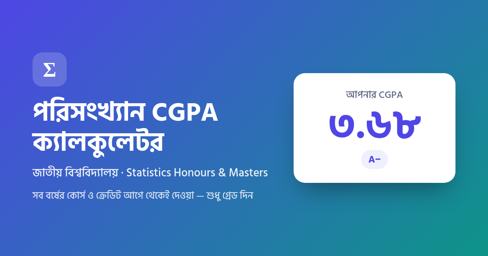

# NU পরিসংখ্যান CGPA ক্যালকুলেটর

**National University (Bangladesh) Statistics — GPA & CGPA Calculator**

🔗 **Live:** https://mamun-abdu.github.io/nu-stats-cgpa-calculator/



জাতীয় বিশ্ববিদ্যালয়ের পরিসংখ্যান অনার্স (১ম–৪র্থ বর্ষ) ও মাস্টার্স শিক্ষার্থীদের জন্য একটি দ্রুত, মোবাইল-বান্ধব GPA ও CGPA ক্যালকুলেটর। প্রতিটি বর্ষের কোর্স কোড, নাম ও ক্রেডিট আগে থেকেই দেওয়া আছে — শুধু গ্রেড বাছুন বা প্রাপ্ত নম্বর লিখুন।

A fast, mobile-first calculator for NU Statistics students. Every course code, name and credit for each year is preloaded; just pick a grade or type your marks.

## Features

- **All years preloaded** — 1st (36 cr), 2nd (38 cr), 3rd (32 cr), 4th (40 cr) year Honours, plus Masters (36 cr).
- **Grade or marks** — pick a letter grade, or type obtained marks (out of the course's full marks: 100 / 75 / 50 / 25) and it maps to the NU grade automatically.
- **Optional papers** — 4th year “pick any two” papers/labs and Masters “pick any three” papers: choose the ones you took; only chosen courses count.
- **Live year GPA** — credit-weighted GPA, letter grade, credits counted, courses completed and fail (F) count.
- **CGPA** — combines year GPAs weighted by yearly credits. Each year can be *auto* (from the year tab), *manual* (type your published NU GPA) or *excluded*.
- **Bangla first** — Bangla UI (Hind Siliguri font), English course names; accepts Bangla digits (৩.৭৫, ৭৮) in every number field; toggle Bangla/English digits.
- **Saves automatically** in your browser (localStorage) — nothing is sent anywhere.
- Light/dark mode, keyboard-accessible tabs, labelled inputs, copy-result and print.
- No framework, no build step: plain HTML + CSS + JS.

## Grading scale (NU)

| Marks (%) | Letter | Point |
|---|---|---|
| 80–100 | A+ | 4.00 |
| 75–79 | A | 3.75 |
| 70–74 | A- | 3.50 |
| 65–69 | B+ | 3.25 |
| 60–64 | B | 3.00 |
| 55–59 | B- | 2.75 |
| 50–54 | C+ | 2.50 |
| 45–49 | C | 2.25 |
| 40–44 | D | 2.00 |
| < 40 | F | 0.00 |

- Year GPA = Σ(credit × grade point) ÷ Σ credit
- CGPA = Σ(year GPA × year credits) ÷ Σ year credits
- Results are rounded to two decimals.

## Run locally

```bash
git clone https://github.com/mamun-abdu/nu-stats-cgpa-calculator.git
cd nu-stats-cgpa-calculator
python3 -m http.server 8000   # or just open index.html
node test/calc.test.js        # calculation tests
```

## Files

| File | Purpose |
|---|---|
| `index.html` | Page shell, meta/OG tags |
| `style.css` | Mobile-first styles, light/dark themes |
| `data.js` | Course list for every year + grading scale |
| `calc.js` | Pure calculation logic (also used by tests) |
| `app.js` | UI, persistence |
| `test/calc.test.js` | Node tests for the calculation logic |

## Data source

Course codes, names and credits follow the NU Statistics syllabus as listed on [Outliers Edge Academy](https://www.outliersedgeacademy.com/#cgpa) (1st year: 2024–25 syllabus; 2nd year: 2024–25 provisional syllabus; 3rd & 4th year: 2013–14 syllabus; Masters: effective from 2013–14 session). Thanks to them for compiling it.

## Disclaimer

এটি একটি অনানুষ্ঠানিক হিসাব-সহায়ক টুল। জাতীয় বিশ্ববিদ্যালয় যে ফলাফল প্রকাশ করে, সেটিই চূড়ান্ত ও অফিসিয়াল।

This is an unofficial helper tool. The official result is whatever National University publishes. If you spot a wrong course or credit, please open an issue.

## License

[MIT](LICENSE) © Mamun Abdu
