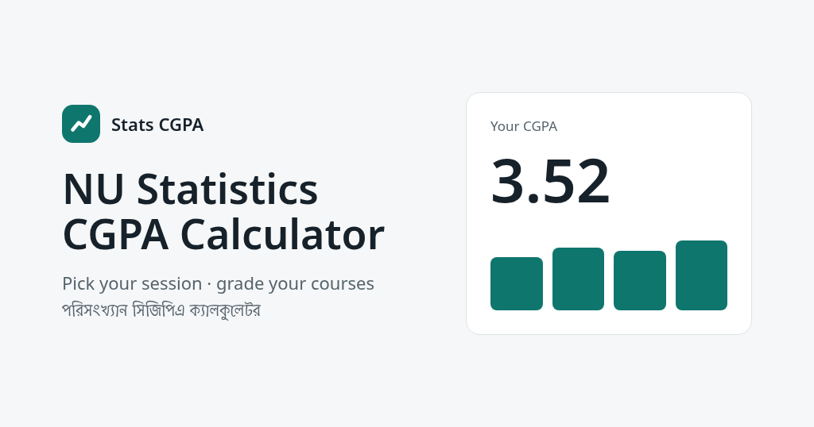

# Stats CGPA

I'm Mamun, a BSc (Honours) Statistics student at Cumilla Victoria Govt. College, 2023-24 session. That makes my batch the last one on the old NU syllabus. I made this GPA and CGPA calculator for National University Statistics students. It works in English and Bangla.

**Live:** https://mamun-abdu.github.io/nu-stats-cgpa-calculator/



## How to use it

1. Pick your session. It's remembered next time.
2. Choose **Honours (B.Sc.)** or **Masters (M.Sc.)** at the top. They're separate degrees, so each one gets its own CGPA, grade mix and result card. Masters never gets added into your Honours CGPA.
3. Pick the grade you got for each course. NU only gives us letter grades, not marks, so there's nothing to type.
4. Your year GPA and CGPA update as you go.

Which syllabus you get depends on your session:

| Sessions | Syllabus | 1st year | 2nd year | 3rd year | 4th year | Masters |
|---|---|---|---|---|---|---|
| 2013-14 to 2023-24 | 2013-14 syllabus | 28 cr | 28 cr (+ non-credit English) | 32 cr | 40 cr | 36 cr |
| 2024-25 onward | 2024-25 syllabus | 36 cr | 38 cr | not published yet | not published yet | not published yet |

For 2024-25 and later, NU has only put out 1st and 2nd year so far. The other years say so, and if you already have a result you can type in your published GPA (it's marked as unofficial). I'll add the new 3rd and 4th year courses once NU publishes them.

A few NU details I made sure to get right:

- 2nd-year English (221109) in the old syllabus is non-credit. It's listed, but it doesn't touch your GPA, and the year shows 700 marks with English separate.
- In 4th year you take any two of the three optional papers and any two of the three optional labs. Only the ones you tick count, so the year stays at 40 credits.
- Masters optionals work the same way, any three.

## What else it does

The main screen stays simple: pick grades, see your CGPA. Everything else is one tap away.

- **CGPA so far.** The year chart shows each year's GPA, plus your running CGPA under it, so you can see if you're trending up or down.
- **Target planner.** Type the CGPA you want and it tells you the GPA you need over your remaining credits.
- **What if…** Open it under the planner to see your final Honours CGPA if the rest of your courses average A+, A, A-, and so on.
- **Result card and PDF.** Download a PNG result card, or print / save a one-page summary.
- **Backup and data** (tucked away under the course list):
  - Export and import a backup file (JSON).
  - Export your grades as a CSV to open in Excel or Google Sheets, and import that CSV back.
  - Clear everything.
- Light and dark mode, and a full Bangla interface.
- Works offline and can be installed like an app.
- Everything is saved in your own browser (localStorage). Nothing is sent anywhere.

### The grades CSV

The export has one row per course:

```csv
session,year,code,course,credits,counted,grade,point
2023-2024,y1,213601,Introductory Statistics,4,yes,A,3.75
```

`year` is `y1` to `y4`, or `ms` for Masters. `counted` says whether an optional paper is one of the ones you took. When you import, only `year`, `code` and `grade` are required, so you can type one by hand too. Course codes that aren't in the official syllabus and grades that aren't on the NU scale get skipped, and you're told how many.

## How the numbers are worked out

| Marks | Grade | Point |
|---|---|---|
| 80-100 | A+ | 4.00 |
| 75-79 | A | 3.75 |
| 70-74 | A- | 3.50 |
| 65-69 | B+ | 3.25 |
| 60-64 | B | 3.00 |
| 55-59 | B- | 2.75 |
| 50-54 | C+ | 2.50 |
| 45-49 | C | 2.25 |
| 40-44 | D | 2.00 |
| < 40 | F | 0.00 |

Year GPA = Σ(credits × point) ÷ Σ credits. Honours CGPA = Σ(year GPA × year credits) ÷ Σ year credits, over 1st to 4th year only. Everything is rounded to two decimals.

## Where the courses come from

Every course code, title, mark and credit is copied from NU's official syllabus files:

- Honours, 2013-14 syllabus (1st to 4th year): https://www.nu.ac.bd/syllabus-honours.php → *Honours Syllabus 2013-2014*
- 1st year, 2024-25 syllabus: https://www.nu.ac.bd/Syllabus/Syllabus_Honours/BSc_Honours/Statistics_First_Year_Pub_Date_12112025.pdf
- 2nd year, 2024-25 syllabus: https://www.nu.ac.bd/syllabus-honours.php → *Second Year Syllabus — Department of Statistics, 2024–2025*
- One-year Masters, 2013-14 syllabus: https://www.nu.ac.bd/syllabus-masters.php

Each year in the app links to its exact file. If you spot a mistake, please open an issue.

## Running it yourself

It's plain HTML, CSS and JavaScript, no framework and no build step.

```bash
git clone https://github.com/mamun-abdu/nu-stats-cgpa-calculator.git
cd nu-stats-cgpa-calculator
python3 -m http.server 8000   # then open http://localhost:8000
npm test                      # or: node test/calc.test.js
```

| File | What's in it |
|---|---|
| `index.html` | the page |
| `style.css` | styles, light and dark |
| `data.js` | sessions and every year's courses |
| `calc.js` | the GPA/CGPA maths (the tests use this) |
| `i18n.js` | English and Bangla text |
| `app.js` | the interface, saving and export |
| `manifest.webmanifest`, `sw.js`, `icons/` | install and offline bits |
| `test/calc.test.js` | tests for all the maths, the planner, backups and CSV |
| `.github/workflows/test.yml` | runs the tests on every push and pull request |

## Disclaimer

This is unofficial. Your real result is whatever National University publishes.
এটি অনানুষ্ঠানিক হিসাব। জাতীয় বিশ্ববিদ্যালয় যে ফলাফল প্রকাশ করে, সেটিই চূড়ান্ত।

## License

MIT, see [LICENSE](LICENSE).
